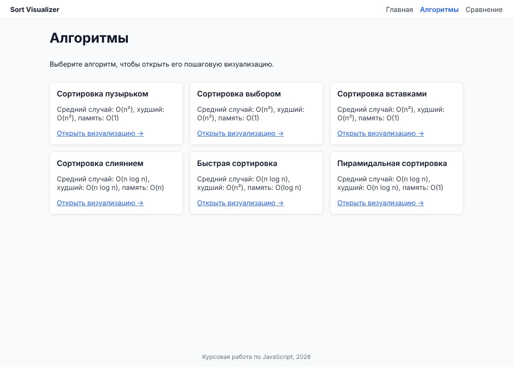
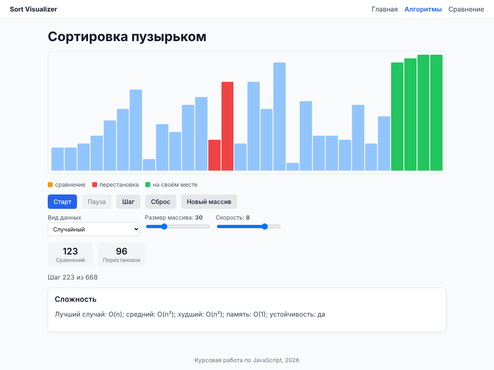
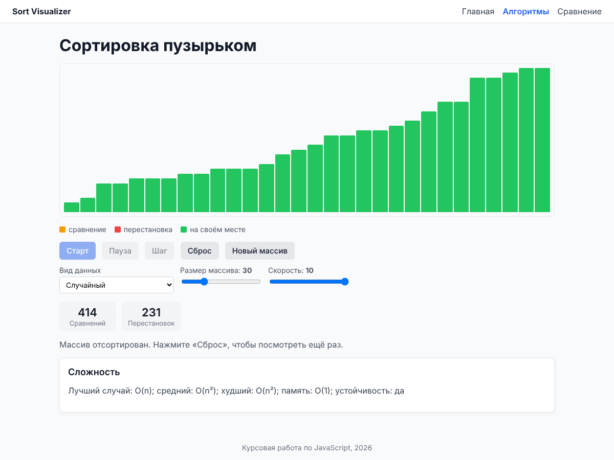

# Sort Visualizer - визуализатор алгоритмов сортировки

Курсовая работа по дисциплине JavaScript: «Разработка визуализатора алгоритмов сортировки с пошаговой анимацией и сравнением производительности с использованием языка JavaScript».

Веб-приложение показывает пошаговую работу шести алгоритмов сортировки: пузырьком, выбором, вставками, слиянием, быстрой и пирамидальной. Ещё оно позволяет сравнить их производительность на одинаковых данных.

Документация:
- [architecture.md](architecture.md) - структура проекта, библиотеки, компоненты, маршрутизация;
- [mvp.md](mvp.md) - use case и границы MVP.

## MVP

В MVP (лабораторная работа 6) реализован основной сценарий из `mvp.md` - пошаговый просмотр работы алгоритма сортировки:

- **Выбор алгоритма.** На странице «Алгоритмы» выбирается один из шести алгоритмов. По адресу вида `/algorithms/quick` открывается его визуализация.
- **Исходный массив.** Массив показан столбчатой диаграммой. Можно выбрать вид данных (случайный, отсортированный, обратно отсортированный, почти отсортированный) и размер (5-100 элементов), а также сгенерировать новый массив.
- **Анимация.**
  - «Старт» запускает анимацию, «Пауза» останавливает её, повторный «Старт» продолжает с того же места.
  - «Шаг» выполняет ровно один шаг.
  - «Сброс» возвращает исходный массив и обнуляет счётчики.
- **Подсветка.** Сравниваемые элементы выделяются оранжевым, переставляемые - красным, стоящие на своём месте - зелёным.
- **Счётчики.** Счётчики сравнений и перестановок обновляются на каждом шаге.
- **Скорость.** Её можно менять во время анимации.
- **Завершение.** Когда массив отсортирован, все столбцы становятся зелёными, а «Старт» недоступен до сброса.
- **Неизвестный алгоритм.** Для адреса с неизвестным алгоритмом (`/algorithms/abc`) показывается сообщение «Алгоритм не найден».

Страница «Сравнение» пока остаётся заглушкой.

## Структура

- `ui-library/` - библиотека общих компонентов (`Button`, `Card`, `Select`, `Slider`, `Stat`, `ArrayBars`);
- `app/` - основное приложение на React + TypeScript + Vite + React Router.

## Запуск

Требуется Node.js 20 или новее.

Сначала соберите библиотеку: приложение использует её сборку из `ui-library/dist`.

```sh
cd ui-library
npm install
npm run build
```

Затем запустите приложение:

```sh
cd ../app
npm install
npm run dev
```

Приложение откроется по адресу http://localhost:5173.

### Команды (в каждом проекте)

| Команда | Действие |
|---|---|
| `npm run dev` | dev-сервер (в `ui-library` - сборка в режиме наблюдения) |
| `npm run build` | сборка |
| `npm run lint` / `npm run lint:fix` | проверка / исправление кода ESLint |
| `npm test` | модульные тесты |
| `npm run test:coverage` | тесты с отчётом о покрытии |

## Демонстрация основного сценария

1. Откройте «Алгоритмы» и выберите «Сортировка пузырьком».
2. Выберите вид данных «Случайный» и размер 30.
3. Нажмите «Шаг» несколько раз: столбцы подсвечиваются, счётчики растут.
4. Нажмите «Старт», затем «Пауза», затем снова «Старт» и увеличьте скорость.
5. Дождитесь сообщения «Массив отсортирован» и нажмите «Сброс».
6. Повторите сценарий для быстрой сортировки на почти отсортированном массиве. Сравнений получается заметно больше: это худший случай для выбранной реализации.

## Скриншоты

Список алгоритмов:



Пошаговая анимация: красным выделена перестановка, зелёным - элементы на своих местах:



Сортировка завершена:



Главная страница:


